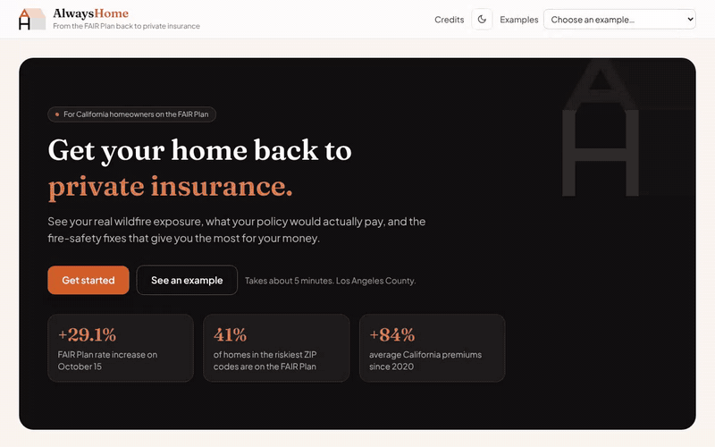
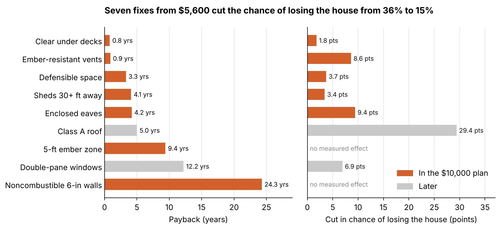
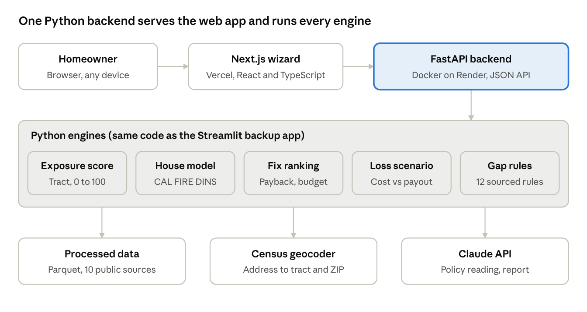

# AlwaysHome

A web app that shows a Los Angeles County homeowner on the California FAIR Plan which fire-safety fixes cut their wildfire risk the most for the money, and what their insurance would really pay if the house burned down.



[](https://github.com/joaquinramirezg/alwayshome/actions/workflows/ci.yml)

**[Try the live app](https://msba-vibathon-2026.vercel.app)** · built in one day by a team of three at the UCLA Anderson MSBA Vibathon 2026 (Nov 6 2026), theme 04 "Uninsurable".

> The API runs on a free host that sleeps when idle, so the first request can take up to a minute. The app shows a wake-up message while it waits. Pick an address under **Examples** to see a full run without typing.

## Result

For a sample Altadena homeowner (a 1952 wood-roof house, FAIR Plan only, $10,000 budget):

- If the house burned, rebuilding and living elsewhere would cost **$850K to $1.5M**; the policy would pay **$595K to $715K**, leaving **$255K to $805K** out of pocket.
- Seven fixes costing from **$5,600** cut the chance of losing the house if fire reaches it from **36% to 15%**.
- The house-loss model behind that estimate reaches a cross-validated **AUC of 0.80** on the 4,525 homes with every feature recorded, out of **22,071 CAL FIRE inspections** from the January 2025 Eaton and Palisades fires.



## Who it is for, and who pays

**The user is the homeowner.** Specifically, a homeowner in LA County who was non-renewed by their insurer and now holds a FAIR Plan policy, sometimes with a supplemental (DIC) policy, and a limited budget for upgrades. The core plan is free to them.

**The customers are businesses (B2B).** A finished plan gives a clear picture of the home: what has been hardened, what is still missing, and where the coverage gaps are. That is worth money to:

| Who | What they get | How AlwaysHome could earn (proposed) |
|---|---|---|
| Insurers re-entering California | Pre-screened, documented, mitigated homes that fit the state's Safer from Wildfires discounts | Referral fee per qualified lead |
| Brokers and agents | A ready report on the home's features, gaps and completed work | Subscription for client reports |
| Contractors | Homeowners who already know which job pays back first | Referral fee |
| Cities, counties, lenders | A neighborhood view of mitigation progress | Data and dashboard license |

The revenue model is a proposal; none of it was tested.

## The problem

Major insurers have stopped writing new policies in California, and more homeowners are pushed onto the FAIR Plan, the state's insurer of last resort. It costs more and covers less: fire only, no theft, water damage or liability. The state rewards specific fire-safety work with discounts, but nobody tells a homeowner which fixes matter most for their house, what each one costs, or what it would save. So they spend on the wrong upgrades or do nothing. Many also do not know how underinsured they are: after the 2025 fires, families found their limits did not cover rebuilding, code upgrades or two to three years of rent.

## How it works

A five-step wizard, about two minutes end to end:

1. **Location.** Type an address. The app shows a wildfire exposure score (0 to 100), the mapped hazard zone, fires within 5 km and the ZIP's insurance market.
2. **Your home.** Eight questions (roof, eaves, vents, siding, windows, deck, attached fence, sheds), the same features CAL FIRE inspectors record. "I don't know" is always allowed.
3. **Insurance.** Upload the declarations page. AI fills in the form and shows the exact line it read for every value; the homeowner confirms. Manual entry always works.
4. **Your situation.** The chance of losing the house if fire reaches it, what a total loss would cost, what the policy pays, what the homeowner pays, and the coverage gaps ranked by severity.
5. **Your plan.** Fixes ranked by payback, a budget slider that rebuilds the plan live, risk before and after, and a report to download or take to a broker.

### What is AI and what is not

The AI does one job people find hard, reading an insurance policy, and is kept away from every number. **Every cost, probability and payback comes from code and public data.**

| Step | How it is computed |
|---|---|
| Wildfire exposure score | Deterministic. Equal-weighted index of four tract indicators (share in Very High zones, share in High zones, share ever burned, FEMA expected annual loss) for all 2,498 LA County census tracts |
| Chance of losing the house | Statistical model. Logistic regression on the 8 home answers plus a fire-by-ZIP effect, trained on CAL FIRE inspections |
| Fix ranking | Deterministic. Each fix is valued by switching one answer to its hardened value and re-scoring the home; fixes are sorted by payback and added while they fit the budget |
| Total-loss scenario and coverage gaps | Deterministic. Rebuild, code upgrade, other structures, contents and rent while rebuilding, compared with the policy limits; 12 gap rules, each with a source |
| Reading the declarations page | **AI (Claude API).** Returns 17 fields, each with the quote and page it came from |
| Plain-language report | **AI, optional.** Rewrites the template report and must keep every number exactly; if the call fails, the template is shown |

Guardrails on the AI step: every quote is checked against the PDF's own text layer ("quote found" or "check this"), impossible values are rejected, the homeowner confirms every value, the PDF is processed in memory and never stored, the API key stays on the server, and AI calls are capped per visitor per hour.



### Data

Ten public sources, all processed by scripts that can be rerun: CAL FIRE damage inspections (DINS) and fire hazard severity zones, California fire perimeters since 1950, the FEMA National Risk Index, California Department of Insurance policy data by ZIP and its Safer from Wildfires list, Zillow Research, the Census geocoder and ACS, and the HUD ZIP-tract crosswalk. Details: [docs/data_dictionary.md](docs/data_dictionary.md) and [docs/validation_report.md](docs/validation_report.md).

## Decisions

- **The AI never produces a number.** We gave up a faster build (let a model estimate costs and savings) for figures we can trace to a source. Getting real contractor quotes and insurer discount filings is what would change the numbers.
- **A simple model, with a known leak removed.** Inspectors mark "Unknown" far more often on destroyed homes, so "Unknown" gets its own term in training and is never used to predict; a homeowner's "I don't know" is scored as the average of known answers. A more complex model would only add value with more fires to train on.
- **Every network or AI step has a fallback.** Three cached addresses and seven sample policies run with no network, so a live demo cannot dead-end.

## Run it

```
uv sync
uv run uvicorn api.main:app --port 8000          # API
cd web && npm install && npm run dev              # app at http://localhost:3000
```

`http://localhost:3000/?demo=altadena_fair_only&step=5` opens a filled-in example. Set `ANTHROPIC_API_KEY` to read new policy PDFs; without it, the sample policies (already read) and manual entry still work. A simpler Streamlit version runs with `uv run streamlit run app.py`.

Tests: `uv run pytest -q` runs 522 tests with no API key (the Claude calls are faked), also on every push in GitHub Actions. Full guide: [docs/TESTING.md](docs/TESTING.md). Deployment: [docs/DEPLOYMENT.md](docs/DEPLOYMENT.md).

## Known limitations

- Los Angeles County only.
- Fix costs and insurance discounts are labelled assumptions; there is no public price per fix or premium per home.
- The house-loss model shows associations from two fires, not causes. Where the data show no benefit (siding, attached fence), the app claims none.
- Insurance market data ends in 2023 and the FAIR Plan share is from 2022, both before the January 2025 fires.
- Total loss only, no partial claims. Not insurance advice and not an inspection.

## Team

| | Role | Built |
|---|---|---|
| **David Ewenczyk** | Chief Data Officer | The data pipeline for LA County and the total-loss coverage model |
| **Joaquin Ramirez** | Chief Product Officer | The homeowner experience end to end: the AI policy reader, the house-damage model, and the platform (API, web app, hosting) |
| **Atharva Uplap** | Chief Risk Officer | The wildfire exposure index, and the insurance gap and recommendations engine |

## Status

Prototype, built in one day on Nov 6 2026 and kept as it was presented. Next steps we would take: real fix prices and insurer discounts, photo and aerial pre-fill of the home questions, statewide coverage, and a referral path from a finished plan to insurers writing in that ZIP.
